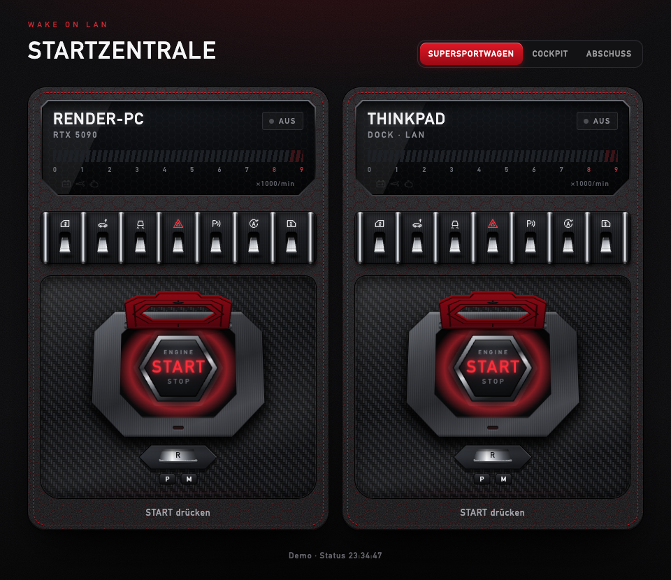
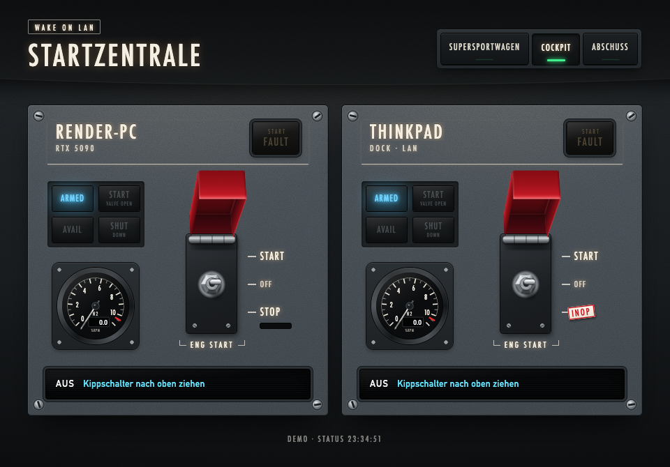
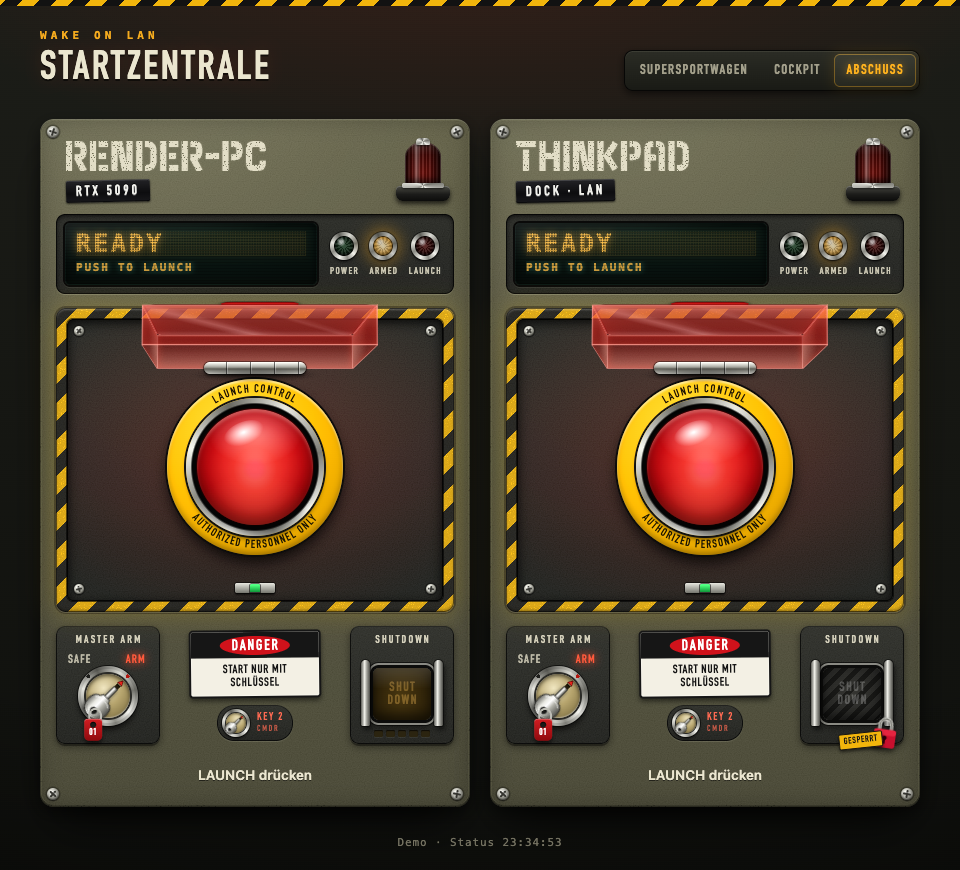
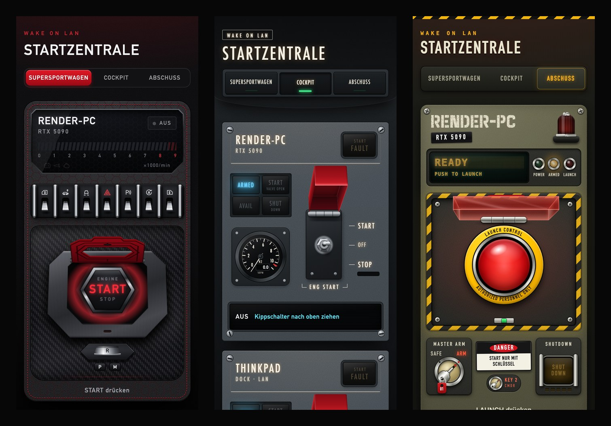

# pi-wol

> Raspberry Pi wake-on-LAN hub with a web UI offering three themed launch panels (supercar, cockpit, launch control); it detects device status via Tailscale and ARP and shuts devices down over SSH.

A Raspberry Pi that wakes my render PC and a laptop with Wake-on-LAN, shows whether they are running and
shuts them down again over SSH. It is reachable on the home network and through Tailscale, so I can start
the PC from my phone while I am away.

The web UI ("Startzentrale", German for *launch centre*) has three switchable, skeuomorphic designs. Each
one uses a two-step safety mechanism, so a stray tap never starts or stops a machine.



| Cockpit: guarded toggle switch | Launch control: key, cover and big red button |
| --- | --- |
|  |  |



The interface text is German (Swiss spelling). Labels in the style of the real-world models stay English
(ENGINE START, MASTER ARM, LAUNCH).

**Try it without a Pi:** the [live demo](https://aralimnga.github.io/pi-wol/) runs the UI in demo mode, or run it locally:

```bash
cd pi/web && python3 -m http.server 8712
# open http://localhost:8712/?demo  (add &thema=lambo|cockpit|atom to pick a design)
```

In demo mode a started device reports "awake" after 6 s and a stopped one reports "off" after 4 s.

## Features

- **Wake-on-LAN**: magic packet to the subnet broadcast and `255.255.255.255`, UDP ports 9 and 7.
- **Status detection that gets past the Windows firewall.** On a network profile set to "Public",
  Windows blocks ping and SSH from the LAN. The check runs in this order: Tailscale peer `Online`,
  then TCP 22/3389 over Tailscale and the LAN, then ARP (`arping`). The network card answers ARP even
  when the firewall blocks everything else.
- **DHCP-proof**: the current LAN IP of a device is learned from Tailscale (`CurAddr`), with the
  configured IP as a fallback.
- **Shutdown over SSH** with the Pi's own key. This is optional per device. Without SSH, STOP is shown
  as locked.
- **Three designs**:
  - Supercar: start button under a red flip cover, in a centre console.
  - Cockpit: overhead panel with a guarded toggle switch, annunciator lights and an N2 gauge.
  - Launch control: key switch to ARM, then lift the cover, press LAUNCH and watch a 3-2-1 countdown
    that you can still abort.
- **Same safety rules in every design.** Starting takes two steps. Stopping takes two steps plus holding
  for 1.5 s. Arming falls back after 15 s, and taps during an animation are ignored. The binding
  contract for design modules is in [`THEMEN.md`](THEMEN.md) (German).
- **Works offline.** There are no CDNs, external fonts or images, and the Python side uses only the
  standard library.
- **Usable on phones and with a keyboard**: it works at 375 px wide, has `aria-label`s and visible focus,
  and respects `prefers-reduced-motion`.
- **Card builder** (`karte_bauen.py`): prepares a freshly flashed Raspberry Pi OS Lite card with
  cloud-init. It sets up the user, SSH key and WLAN and copies a first-boot installer to the card.

## How it works

```
Phone / laptop browser ── LAN or Tailscale ──▶ pc-wecken-web (Pi, port 80, systemd)
                                                   │  GET  /api/geraete       status of all devices (polled every 3 s)
                                                   │  POST /api/an/<id>       send magic packet
                                                   │  POST /api/aus/<id>      shut down over SSH
                                                   ▼
                                               pc-wecken (CLI + library)
                                                   ├─ UDP broadcast ──▶ NIC of the sleeping PC
                                                   ├─ tailscale status / TCP 22,3389 / arping
                                                   └─ ssh admin@pc "shutdown /s /t 5"
```

## Repository layout

```
karte_bauen.py           prepares the SD card (cloud-init user-data, network-config, copies pi/)
pi/einrichten.sh         first-boot installer, runs as root via cloud-init (re-runnable)
pi/pc-wecken             CLI: list, wake, shut down, status
pi/pc-wecken-web         web server and JSON API (pc-wecken-web.service)
pi/geraete.example.json  device list template; your real list goes to pi/geraete.json (gitignored)
pi/web/                  UI frame (index.html, app.js, basis.css) and themes/<id>.js|.css
THEMEN.md                contract for design modules (German)
tools/shot.mjs           screenshot helper via the Chrome DevTools Protocol
docs/screenshots/        images for this README
```

## Setup

### 1. Device list

```bash
cp pi/geraete.example.json pi/geraete.json   # stays local, see .gitignore
```

| Field | Meaning |
| --- | --- |
| `id`, `name`, `info` | Key for the API/CLI, display name, small subtitle on the card |
| `mac` | MAC address of the wired network card that should wake the device |
| `lan_ip` | LAN address (fallback if Tailscale does not know the current one) |
| `ts_ip` | Tailscale address (100.x) used for the status check |
| `broadcast` | Subnet broadcast, for example `192.168.1.255` (string or list, optional) |
| `ssh` | `user@host` for shutting down, or `null` to disable STOP |
| `aus_befehl` | Shutdown command on the target, default `shutdown /s /t 5` (Windows) |

### 2. Flash and prepare the card (macOS)

```bash
# Raspberry Pi OS Lite (arm64, Trixie, cloud-init)
curl -fL -o pios.img.xz https://downloads.raspberrypi.com/raspios_lite_arm64_latest && xz -d pios.img.xz
diskutil list external physical                       # find the card: /dev/diskN
diskutil unmountDisk /dev/diskN && /usr/libexec/authopen -w /dev/rdiskN < pios.img
diskutil mount diskNs1

# Passwords are prompted when omitted; only the hash of the user password is written
python3 karte_bauen.py --boot /Volumes/bootfs --ssid '<wlan>' --geraete pi/geraete.json
# optional: --hostname, --land, --zeitzone, --tastatur, --dtoverlay '<display overlay>', --wlan-von <old network-config>
diskutil eject /dev/diskN
```

`karte_bauen.py` needs an OpenSSL that supports `passwd -6` (`brew install openssl`; the LibreSSL that
ships with macOS cannot do it) and PyYAML only for `--wlan-von`.

### 3. First boot

`pi/einrichten.sh` installs the CLI, the web service and the device list (or the template if you did not
pass one) and creates an SSH key for the Pi. Then it installs `iputils-arping`, `avahi-daemon` and
Tailscale. The log is at `/var/log/pi-wol-einrichten.log`. Afterwards run `sudo tailscale up` once.

- LAN: `http://pi-wol.local`, Tailscale: `http://pi-wol` (MagicDNS) or the Pi's 100.x address
- CLI on the Pi: `pc-wecken`, `pc-wecken an pc --warten`, `pc-wecken aus pc`, `pc-wecken status pc`
- Devices: `/etc/pc-wecken/geraete.json` (copied only on the first run; later edits on the Pi are kept)

### Shutdown over SSH (Windows target)

Put the Pi's `/home/admin/.ssh/id_ed25519.pub` into `C:\ProgramData\ssh\administrators_authorized_keys`
on the Windows machine (for an admin account) and set `"ssh"` in the device list.

### Wake-on-LAN from soft-off (S5)

- Windows network adapter: enable "Wake on Magic Packet" and "Shutdown Wake-On-Lan"; turn off Fast Startup.
- BIOS/UEFI: disable ErP and enable wake from PCI-E (the names vary by mainboard).
- The power supply must stay powered (no switched-off power strip).
- Laptops usually wake only over Ethernet or a dock and only on AC power.
- Tailscale on Windows: `tailscale set --unattended` keeps it connected before anyone logs in, so the
  status shows "on" right after boot.

## Configuration through environment variables

| Variable | Default | Used by |
| --- | --- | --- |
| `PCW_GERAETE` | `/etc/pc-wecken/geraete.json` | CLI, web |
| `PCW_BROADCAST` | empty | additional broadcast addresses, comma-separated |
| `PORT` / `PCW_BIND` | `80` / all interfaces | web |
| `PCW_HOSTS` | empty | additional allowed host names, comma-separated |
| `PCW_WEB`, `PCW_PFAD` | `/usr/local/share/pc-wecken/web`, `/usr/local/bin/pc-wecken` | web |

## Security notes

- **There is no login.** Anyone who can reach the Pi on the LAN or the tailnet can wake the configured
  devices and shut down those that have SSH set up. Do not expose port 80 to the internet. Use Tailscale
  ACLs if other people share your tailnet.
- The server protects against attacks through the browser. It only accepts its own host names: IP
  addresses, `localhost`, `<hostname>`, `<hostname>.local`, `<hostname>.<tailnet>.ts.net` and `PCW_HOSTS`.
  This blocks DNS rebinding. `POST` requests also need the header `X-PCW: 1` and a matching `Origin`, so
  a random web page open on a phone in the same network cannot trigger an action (CSRF).
- The Pi's SSH key gives an admin login on the target machine, so keep the Pi itself locked down. The
  card builder enables SSH password login as a fallback. Turn it off (`PasswordAuthentication no`) once
  key login works.
- cloud-init stores the WLAN password in plain text in `network-config` on the card's boot partition.

## Built with

Python 3 (standard library only), vanilla JavaScript and CSS, Raspberry Pi OS Lite with cloud-init,
systemd and Tailscale.

This project was built with AI coding agents (Claude Code by Anthropic). I defined the goal, the
hardware setup, the safety rules and the design contract in `THEMEN.md`. The agents wrote most of the
code, including the three design modules.

The original version was tested end to end on the real hardware: a stopped PC showed as "off" after about
30 s, and a woken PC showed as "on" after about 40 s without anyone logging in. This cleaned-up public version
changes exactly the parts that matter for that test: the broadcast address now comes from the configuration
(without a `"broadcast"` field or `PCW_BROADCAST` the packet only goes to 255.255.255.255), POST requests need the `X-PCW` header
and a matching `Origin`, and `karte_bauen.py` was reworked. So far it has only been tested on macOS (web UI
with a test configuration, `karte_bauen.py` against a dummy boot folder), not yet on a Raspberry Pi.

## License

[MIT](LICENSE) © 2026 Aralim (AralimNGA)
